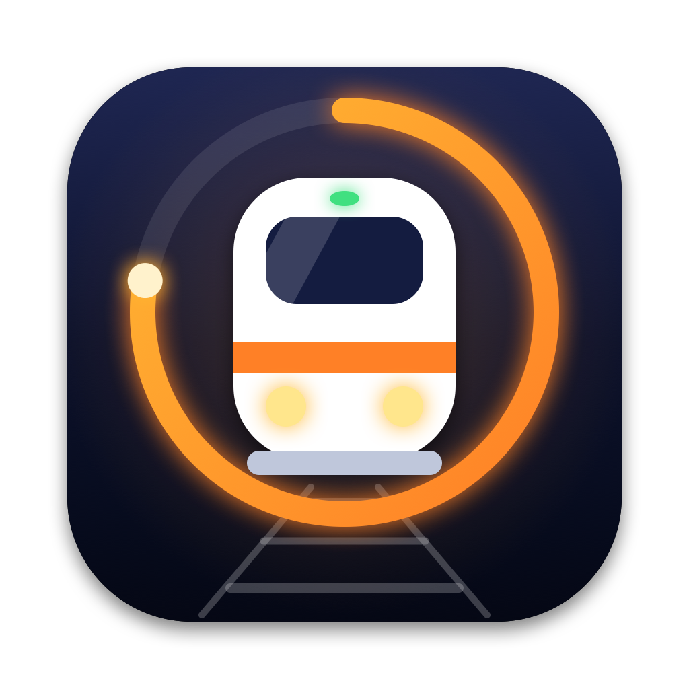
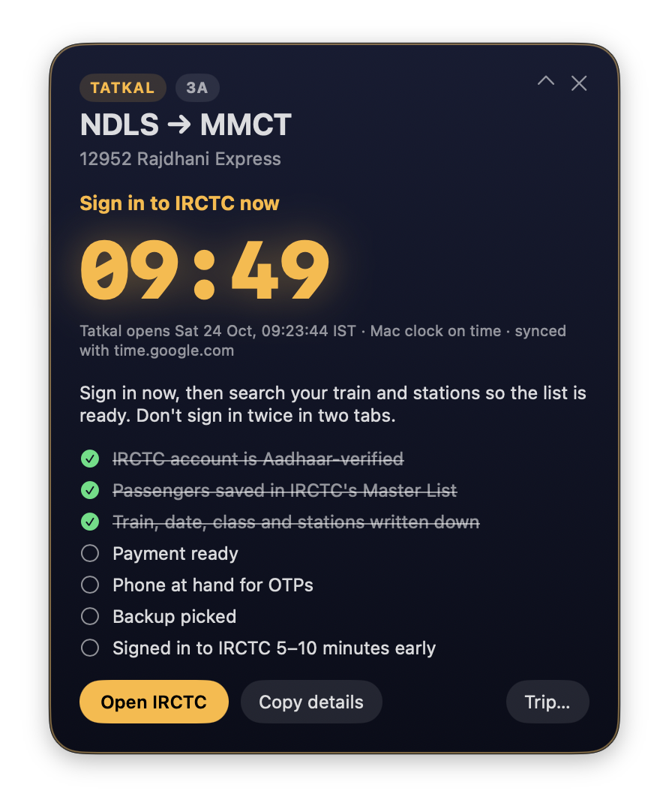
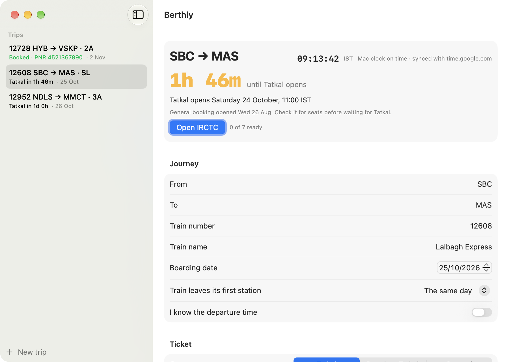
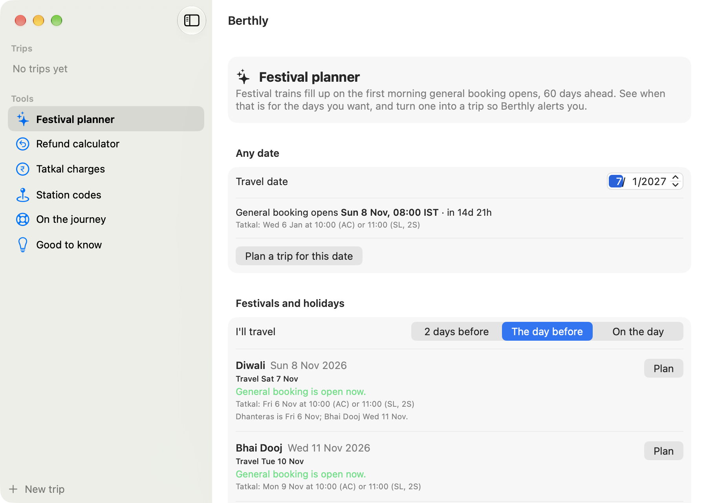

<div align="center">



# Berthly

**Be ready the second IRCTC Tatkal and general booking opens.**

A small macOS menu-bar app for Indian Railways trips. Add a trip and Berthly works out when
booking opens, counts down to the second on an internet-synced clock, walks you through a
checklist, and opens IRCTC so you're signed in before the rush.



</div>

> [!IMPORTANT]
> **Berthly never books for you.** You sign in, pick passengers, approve the Aadhaar OTP and
> pay on IRCTC yourself. It doesn't fill forms, solve CAPTCHAs, use more than one account or
> touch IRCTC in the background. Automated booking breaks IRCTC's terms and the Railways Act.
>
> Berthly is not affiliated with IRCTC or Indian Railways.

---

## What it does

| | |
|---|---|
| **Knows when booking opens** | Tatkal and Premium Tatkal: 10:00 IST for AC classes and 11:00 IST for SL and 2S, the day before the train leaves its first station. General: 08:00 IST, 60 days ahead. All times are IST, whatever time zone your Mac is in. |
| **Boarding mid-route** | If the train started its run the day before you board, pick **1 day earlier** and Tatkal is worked out from the train's start date, the way IRCTC does it. |
| **Counts down to the second** | The menu bar shows `🚆 1:52:07` in the last 3 hours. The clock is checked against internet time servers, so a Mac clock that's a few seconds off doesn't cost you the seat. |
| **Alerts at the right moments** | The evening before, 30 min, 10 min and 2 min before opening, and at opening. The 10-minute alert opens IRCTC so you can sign in early. Soft ticks count down the last 10 seconds. |
| **Readiness checklist** | Aadhaar-verified account, Master List passengers, payment, phone for OTPs, backup train, signed in early. Tick it off on the alert card or in the trip. |
| **After booking** | Save the PNR and status. Berthly works out when the chart is due and alerts you 15 minutes before, then copies the PNR and opens the official Indian Railways PNR page. |
| **Add to Calendar** | Puts the booking opening, the journey and the chart into Calendar, with alerts. The PNR is never written into the event. |
| **Station names as you type** | Type `SC` and Berthly shows Secunderabad Jn. Type an old code like `ALD` and it offers the new one (PRYJ). |
| **✨ Trip coach** | Optional. Asks Claude for a short plan: which quota to aim for, a minute-by-minute plan for opening time, and fallbacks such as other trains, nearby stations, another class or Vikalp. |



### 🧰 Rail tools

In the trips window sidebar, or menu → **Rail tools**.

| Tool | What it gives you |
|---|---|
| **Festival planner** | Diwali, Chhath, Holi, Eid, Pongal, Onam, Durga Puja, summer holidays and more through 2027. For each one, the exact morning general booking opens for the day you'd travel, with a countdown, and the Tatkal day. **Plan** turns it into a trip so you're alerted. Works for any date too. |
| **Refund calculator** | What you'd get back if you cancel now (or at any time you pick), by class, quota, status, fare and passengers. Fills in from a booked trip. Each booked trip also shows "If you cancel now: about ₹…". |
| **Tatkal charges** | The Tatkal charge per class (a share of the basic fare between a minimum and a maximum), and a calculator for your fare. |
| **Station codes** | Search 8,953 stations by name, city or code, offline. Shows renamed stations and their old codes. |
| **On the journey** | Rail Madad complaints, IRCTC e-Catering, retiring rooms, NTES running status, PNR status and the 139 helpline, plus when and how to file a TDR. |
| **Good to know** | VIKALP alternate trains, free auto-upgrade, lower berths for seniors and women, the senior citizen concession, passengers per ticket, Aadhaar for Tatkal, ID on board. |



<sub>The screenshots use made-up trips.</sub>

---

## Requirements

- macOS 14 Sonoma or later, on Apple Silicon or Intel.
- An IRCTC account. For Tatkal, it must be Aadhaar-verified (My Account → Authenticate User).
- For the ✨ coach only: the [Claude command-line tool](https://docs.anthropic.com/en/docs/claude-code) (`claude`), signed in.

---

## Install

1. Download **Berthly.dmg** from the [latest release](../../releases/latest).
2. Open it and drag **Berthly** into **Applications**.
3. Open Berthly from Applications.

   The first time, macOS will block it with a message that it "can't be opened" or is from an
   unidentified developer. This is expected, because the app isn't notarized by Apple. To
   allow it:
   - Open **System Settings → Privacy & Security**.
   - Scroll down to the message about Berthly and click **Open Anyway**, then confirm.

   Or, in Terminal:
   ```
   xattr -dr com.apple.quarantine /Applications/Berthly.app
   ```
4. The trips window opens. Click **Add a trip**. After that, Berthly lives in the menu bar as
   🚆. There's no Dock icon.

To see an alert right away, open the menu and choose **✨ Preview an alert → 10 minutes before**.

### Build from source

```
git clone https://github.com/Sravankumartangudu/berthly.git
cd berthly
./build.sh --install     # builds a universal app into ~/Applications and opens it
```

You only need the Xcode Command Line Tools (`xcode-select --install`). `./build.sh --dist` also
makes `build/Berthly.dmg` and `build/Berthly.zip`. Run the rules tests with:

```
swiftc -o /tmp/berthly-tests tests/main.swift Sources/Rules.swift Sources/Store.swift Sources/Alerts.swift Sources/Clock.swift \
  Sources/Toolkit.swift Sources/CalendarExport.swift Sources/Stations.swift && /tmp/berthly-tests   # run from the repo folder
swiftc -o /tmp/berthly-clock tests/clock/main.swift Sources/Clock.swift && /tmp/berthly-clock
```

---

## Using it

| You want to… | Do this |
|---|---|
| Add a trip | Menu → **New trip…** (⌘N). Fill in stations, train, boarding date, class and quota. |
| See all trips | Menu → **Show trips** (⌘T), or click a trip in the menu. |
| Get the opening time right for a mid-route boarding | In the trip, set **Train leaves its first station** to **1 day earlier** (or 2, 3). |
| Get a chart alert | Add the **departure time** and, once booked, the **PNR**. |
| Check a PNR | **Check PNR on Indian Railways** in the trip. The PNR is copied, so paste it on the page. |
| Put it in Calendar | **Add to Calendar** in the trip. Calendar opens and asks which calendar to add the events to. |
| Find a station code | Type a name under **From** or **To** and click a match, or use **Rail tools → Station codes**. |
| Know what a cancellation costs | Add the **fare** after booking, or open **Rail tools → Refund calculator**. |
| Share the plan | **Copy details** gives you a plain-text summary for a note or a message. |
| Try the alerts | Menu → **✨ Preview an alert** → any stage. Previews use a made-up trip that isn't saved. |

When alerts appear:

| Alert | When | Still shows if your Mac was asleep |
|---|---|---|
| Get ready for tomorrow | 20:00 IST the evening before opening day | up to 3 hours late |
| Opens in 30 minutes | 30 min before | up to 20 min late |
| Sign in to IRCTC now | 10 min before (opens IRCTC) | up to 8 min late |
| Two minutes to go | 2 min before | up to 2 min late |
| Booking is open | at opening | up to 10 min late |
| Chart is due soon | 15 min before the expected chart (booked trips) | up to 2 hours late |

Each alert shows once per trip. The card can be shrunk to a small pill with **⌃** and stays above
other windows on every Space.

### The rules Berthly uses

Checked in October 2026. Indian Railways changes them now and then. If something looks off,
check [irctc.co.in](https://www.irctc.co.in/).

| | |
|---|---|
| **General** | 08:00 IST, 60 days before the train starts (the journey day not counted). The first 15 minutes are for Aadhaar-verified accounts. |
| **Tatkal (AC)** | 10:00 IST the day before the train leaves its first station: 2A, 3A, 3E, CC, EC. |
| **Tatkal (non-AC)** | 11:00 IST the same day: SL and 2S. |
| **Premium Tatkal** | Same times as Tatkal, with fares that rise as seats sell. |
| **Aadhaar** | Online Tatkal needs an Aadhaar-verified IRCTC account and an Aadhaar OTP while booking. Agents can't book in the first 30 minutes. Up to 4 passengers per Tatkal ticket. |
| **Passengers** | Up to 6 on a general ticket and 4 on a Tatkal ticket. There's no Tatkal or Premium Tatkal in 1A. |
| **Chart** | 20:00 the evening before for trains leaving 05:00–14:00; about 10 hours before departure for the rest. The final chart comes 30 minutes before departure. |

### Refunds and charges

The refund calculator follows the Railway Passengers (Cancellation of Ticket and Refund of Fare)
Rules, 2015, with the time slabs reported as changed in April 2026.

| Ticket | Cancelled | Deducted |
|---|---|---|
| Confirmed | more than 72 h before departure | Flat charge per passenger: 1A and EC ₹240, 2A ₹200, 3A, 3E and CC ₹180, SL ₹120, 2S ₹60 |
| Confirmed | 72–24 h before | 25% of the fare, at least the flat charge |
| Confirmed | 24–8 h before | 50% of the fare, at least the flat charge |
| Confirmed | under 8 h before | No refund |
| RAC or waitlisted | up to 30 min before | ₹60 per passenger |
| Confirmed Tatkal or Premium Tatkal | any time | No refund |

> [!NOTE]
> These are estimates. Until March 2026 the slabs were 48, 12 and 4 hours (the 2015 Gazette),
> and some official pages still show those. I couldn't find the circular for the April 2026
> change, so treat the slabs as reported, not confirmed. GST is added to the charge on AC
> classes, and IRCTC's booking fee isn't refunded. Vande Bharat Sleeper and Amrit Bharat trains
> have stricter rules. IRCTC shows the exact amount before you confirm a cancellation.

Tatkal charges per passenger, from IRCTC's Tatkal FAQ: 2S 10% of the basic fare (₹10–15); SL 30%
(₹100–200); CC 30% (₹125–225); 3A 30% (₹300–400); 2A and EC 30% (₹400–500). 3E isn't listed, so
Berthly shows the 3A figures.

Festival dates follow Drik Panchang (New Delhi) and the central government holiday list. Dates
that depend on the moon, like Eid, can move by a day.

---

## Settings

Everything is under **⚙ Settings** in the menu.

| Setting | Options |
|---|---|
| **Alerts → Open IRCTC with the 10-minute alert** | On (default) / off |
| **Alerts → Tick through the last 10 seconds** | On (default) / off |
| **Alerts → Alert before the chart comes out** | On (default) / off |
| **Alerts → Alert sound** | Off, Glass (default), Hero, Ping, Pop, Purr, Submarine, Tink |
| **Alerts → Voice announcement** | Speaks "Tatkal. Sign in to IRCTC now." |
| **Clock** | Shows how far off your Mac's clock is. **Sync clock now** checks again (it also checks every 30 minutes). |
| **App → Appearance** | System (default), Light or Dark for the trips window and menus. The alert card is always dark. |
| **App → Launch at login** | On / off |

---

## Privacy

Your trips are saved on your Mac only, in `~/Library/Application Support/Berthly/trips.json`.
Berthly has no server, no account and no analytics. It never sees your IRCTC password, Aadhaar
number or payment details.

Its own network use is limited to two things:

- **Clock check**: asks a public time server (time.google.com, then time.apple.com, then
  pool.ntp.org) for the time. Nothing about you is sent.
- **✨ Trip coach**, only when you click it: sends the trip details (stations, train, date, class,
  quota, passengers, backup, notes and booking status) to Claude through your own `claude`
  command-line tool. It never sends the PNR, because a PNR leads to the passengers' names.

Buttons like **Open IRCTC** and **Check PNR** open the official pages in your browser.

**Add to Calendar** writes a small `.ics` file into a private temporary folder (readable only by
you), hands it to Calendar and deletes it five minutes later. It holds the route, train, class,
quota and times, never the PNR. The station list is built into the app, so searching it sends
nothing anywhere.

Berthly doesn't ask for passenger names, ages, ID numbers, your IRCTC sign-in, Aadhaar or
payment details, and there's nowhere to type them except the free-text **Notes**, which warns you
not to. To delete everything, delete your trips in the app, or quit Berthly and delete the
`~/Library/Application Support/Berthly` folder.

---

## Rules Berthly follows

Berthly is built to stay inside the rules for booking Indian Railways tickets. It is a reminder and
a checklist, not a booking tool.

| Rule | How Berthly keeps to it |
|---|---|
| **Railways Act 1989, section 143** (no unauthorised buying or supplying of tickets) | Berthly never buys, holds or resells tickets. You book your own trips on IRCTC. |
| **IRCTC terms of use** (no automated software, no bots, one personal account) | It doesn't sign in, fill forms, click, scrape or call IRCTC in the background. It only opens IRCTC's own page in your browser. The ✨ coach is told never to suggest bots, autofill tools, CAPTCHA solvers, several accounts or touts. |
| **Tatkal Aadhaar rules** (Aadhaar-verified account, Aadhaar OTP, agents blocked for 30 minutes) | The checklist and alerts remind you to verify your account in advance. Berthly never handles the OTP or your Aadhaar number. |
| **No PNR or seat polling** | The refund calculator, Tatkal charges and festival planner are worked out on your Mac from the published rules. Berthly never checks seats, fares or PNRs online. |
| **PNR enquiry CAPTCHA** | Berthly doesn't read PNR status for you. It copies the PNR and opens the official Indian Railways page, where you enter it yourself. |
| **Digital Personal Data Protection Act 2023** (collect only what's needed, keep it safe, let people erase it) | Only trip details are stored, on your Mac, readable only by your user account. Nothing is uploaded except what you send to the coach yourself, and that never includes the PNR. You can erase everything at any time (see Privacy). |
| **IRCTC and Indian Railways names and logos** | No logos are used. The names appear only to say which official site a button opens. Berthly is not affiliated with IRCTC or Indian Railways. |

This is the developer's reading of the rules as of October 2026, not legal advice. If a rule
changes, Berthly's behaviour should follow it. Please [open an issue](../../issues) if you
spot something out of date.

---

## Security

- No third-party code: Berthly uses only Apple's frameworks. The station list is a data file from
  [datameet/railways](https://github.com/datameet/railways) (CC0, public domain), updated for
  renamed stations.
- The app is signed with the **hardened runtime**, which blocks code injection and debugger
  attachment. It's ad-hoc signed rather than notarized, hence the **Open Anyway** step.
- The clock check rejects forged or broken time-server replies (it sends a random nonce the
  server must echo back) and ignores any reading more than 10 minutes off.
- The ✨ coach runs `claude` with **no tools**, so nothing in a trip's notes can make it run
  commands or read files. To sign in, Berthly briefly copies only the sign-in keys from
  `~/.claude/settings.json` into a file only you can read, and deletes it as soon as the
  coach finishes.
- Every link Berthly opens is a fixed `https://` address in [Sources/Rules.swift](Sources/Rules.swift).

To report a security problem, see [SECURITY.md](SECURITY.md).

---

## Troubleshooting

**macOS says the app is damaged or can't be opened.**
Run `xattr -dr com.apple.quarantine /Applications/Berthly.app` in Terminal, then open it again.

**The opening time looks a day off.**
Tatkal opens by the date the train *leaves its first station*, not your boarding date. If you
board after midnight on a train that started the evening before, set **Train leaves its first
station** to **1 day earlier**.

**The clock line says "Clock not synced yet (using the Mac's clock)".**
Berthly falls back to your Mac's clock. Check System Settings → General → Date & Time → **Set
time and date automatically**, then choose **Sync clock now**.

**An alert didn't appear.**
Check the timing table above. Each alert shows once. Booked trips (with a PNR) only get the
chart alert, and only if they have a departure time.

**A station is missing or has an old name.**
The built-in list dates from about 2016, with renames added up to October 2026. IRCTC's own
station search always has the latest. Please [open an issue](../../issues) with the station.

**The refund estimate doesn't match IRCTC.**
IRCTC's figure is the one that counts. The estimate leaves out GST and IRCTC's booking fee, and
the slabs may differ for some trains (see Refunds and charges).

**The ✨ coach says it needs the Claude command-line tool.**
Install `claude`, sign in once in Terminal, then try again. Berthly finds it in `~/.local/bin`,
`/opt/homebrew/bin` or `/usr/local/bin`.

---

## License

[MIT](LICENSE). Berthly is an independent app. It is not affiliated with, endorsed by or connected
to IRCTC or Indian Railways.
